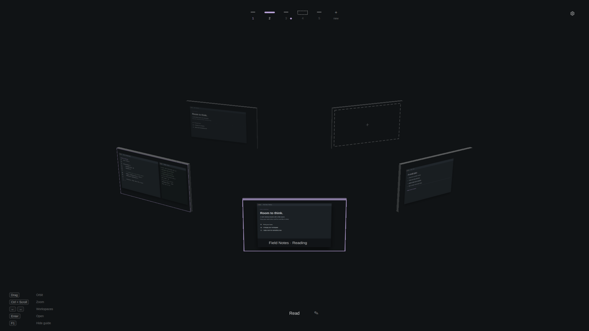
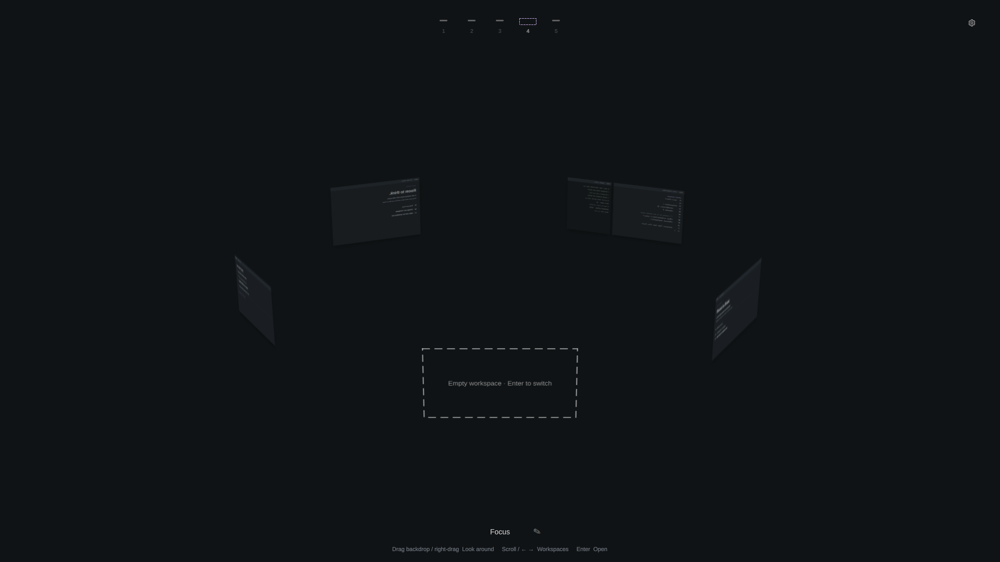
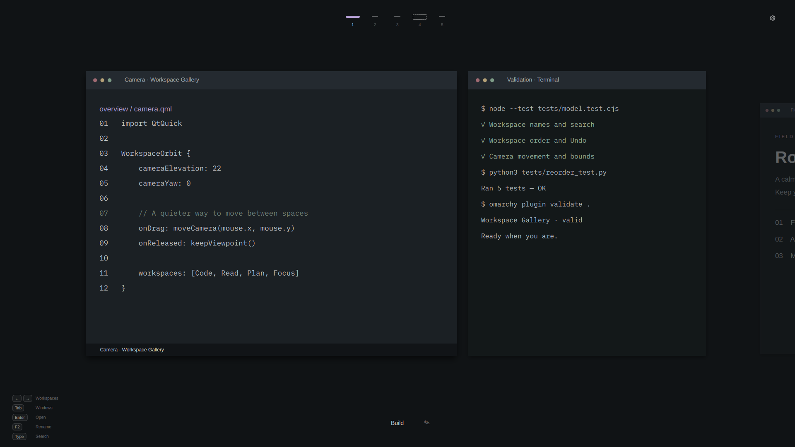

<div align="center">


# Workspace Gallery

Live window previews, searchable workspaces, and an interactive workspace ring for Omarchy.

<p>
  <a href="LICENSE"></a>
  
  
  
  
  
</p>

[Install](#install) · [Controls](#controls) · [Configuration](#configuration) · [Remove](#remove) · [Development](#development)

</div>

---

## Showcase

<!-- 🖼️ PREVIEW IMAGE — replace preview.png (1920 × 1080) with your own screenshot, or change the path below. -->
<p align="center">
  
</p>

<!-- 🎬 DEMO VIDEO — add your clip here:
       1. Put the file at assets/media/demo.mp4 (or upload it to a GitHub issue and paste that URL).
       2. Remove the "<!--" and "-->" markers around the <video> line below".

<p align="center">
  <video src="assets/media/demo.mp4" controls muted width="100%"></video>
</p>
-->

Workspace Gallery is a fullscreen view above your applications and top bar. It does not resize your desktops. Browse live windows, move work between spaces, or lift the view into a circular workspace arrangement. The interface follows your Omarchy palette, with square window previews, soft shadows, and dashed guides for empty workspaces.

<table>
  <tr>
    <td width="50%" align="center">
      <strong>Interactive workspace ring</strong><br><br>
      <a href="preview.png"></a>
    </td>
    <td width="50%" align="center">
      <strong>A place for your next task</strong><br><br>
      <a href="assets/previews/empty-workspace.png"></a>
    </td>
  </tr>
  <tr>
    <td colspan="2" align="center">
      <strong>Normal overview with search and tabs</strong><br><br>
      <a href="assets/previews/overview.png"></a>
    </td>
  </tr>
</table>

> [!NOTE]
> All previews are **1920 × 1080**, rendered from the production UI components with original staged sample windows. They contain no personal desktop content. See [asset provenance and reproduction instructions](assets/previews/README.md).

---

## At a glance

| | Feature | What you can do |
| :---: | --- | --- |
| 🪟 | **Two perspectives** | Switch between the normal overview and an elevated workspace ring. |
| 🎥 | **Interactive camera** | Drag to orbit, raise, or lower your viewpoint, and zoom in on the ring; keep the angle when you release. |
| 🔎 | **Window search** | Find windows by title, application name, or class across workspaces on the focused monitor. |
| 🔀 | **Workspace ordering** | Drag numbered tabs; neighboring tabs slide aside and numeric shortcuts follow the new order. |
| ↩️ | **Window moves & Undo** | Drop a window into another workspace, then undo moves and reorders in chronological order. |
| 🏷️ | **Names & motion** | Name your workspaces and adjust preview size, transition duration, or reduced motion. |

| Plugin ID | Version | Author | License |
| --- | --- | --- | --- |
| `io.github.aicyraa.workspace-gallery` | `1.2.0` | [Aicyraa](https://github.com/Aicyraa) | [MIT](LICENSE) |

---

## Requirements

This plugin runs inside the **Omarchy Quattro shell**.

| | Dependency | Requirement |
| :---: | --- | --- |
| 🧩 | **Omarchy** | Quattro shell with the host `qs.Commons` theme module. Development system: Omarchy `4.0.6-1`. |
| 🪟 | **Hyprland** | Lua dispatchers including `hl.dsp.workspace.change_id`, `hl.dsp.window.move`, and `hl.dsp.focus`. Developed against `0.56.2`. |
| ⚡ | **Quickshell** | Omarchy's build with `Quickshell.Hyprland`, `Quickshell.Wayland` window capture, `Quickshell.Io`, and IPC. Tested with `0.3.2`. |
| 🎨 | **Qt** | Qt Quick, Controls, Shapes, and Effects, supplied by the shell. `RectangularShadow` needs Qt `6.9+`; development system uses Qt `6.12`. |
| ⌨️ | **Commands** | `omarchy`, `omarchy-shell`, `hyprctl`, and `python3` on PATH. |
| 🐍 | **Python** | Python 3 with its standard library; no pip packages. |

> [!NOTE]
> The listed versions describe the development environment, not a compatibility guarantee for every combination. No separate bar plugin, dock, audio service, browser extension, account, remote build, or network service is needed. Node.js and Qt Quick Test are development-only dependencies.

---

## Install

```sh
omarchy plugin add https://github.com/Aicyraa/omarchy-overview.git --enable
```

Omarchy installs the plugin to `~/.config/omarchy/plugins/io.github.aicyraa.workspace-gallery/` and manages its activation. The installer does **not** run the repository's deployment scripts or replace your bar, theme, or keyboard bindings.

Open or close the overview:

```sh
omarchy-shell shell toggle io.github.aicyraa.workspace-gallery
```

### Add your shortcuts

Check for existing bindings first, then add these optional lines to `~/.config/hypr/bindings.lua`:

```lua
o.bind("SUPER + SHIFT + W",      "Workspace overview", "omarchy-shell shell toggle io.github.aicyraa.workspace-gallery")
o.bind("SUPER + SHIFT + CTRL + W", "Workspace ring",     "omarchy-shell io.github.aicyraa.workspace-gallery.perspective toggle")
```

Apply and check the configuration:

```sh
hyprctl reload
hyprctl configerrors
```

| Shortcut | Action |
| --- | --- |
| <kbd>Super</kbd> + <kbd>Shift</kbd> + <kbd>W</kbd> | Open the normal overview. |
| <kbd>Super</kbd> + <kbd>Shift</kbd> + <kbd>Ctrl</kbd> + <kbd>W</kbd> | Switch between the overview and the ring while it is open. Does nothing when the overview is closed. |

---

## Controls

| Action | Keyboard or mouse |
| --- | --- |
| 🗂️ Choose a workspace | <kbd>←</kbd> / <kbd>→</kbd>, scroll, or click a numbered tab |
| 🔭 Zoom the ring | <kbd>Ctrl</kbd> + scroll in the ring view |
| 🪟 Choose a window | <kbd>Tab</kbd> / <kbd>Shift</kbd> + <kbd>Tab</kbd> |
| ✅ Enter workspace / focus window | <kbd>Enter</kbd>, or click a window; click a workspace scene in the ring |
| ❌ Close | <kbd>Esc</kbd>; clears search or closes an editor first |
| 🔍 Search | Start typing or <kbd>Ctrl</kbd> + <kbd>F</kbd> |
| ✏️ Rename workspace | <kbd>F2</kbd> or click the bottom label |
| ⚙️ Preferences | Gear button or <kbd>Ctrl</kbd> + <kbd>,</kbd> |
| ↩️ Undo a move or reorder | <kbd>Ctrl</kbd> + <kbd>Z</kbd> or the Undo notice |

### 🎥 Move the camera

The ring starts at a **22°** elevation.

- Hold **left-click on empty background** and move horizontally to orbit, or vertically to raise or lower the camera.
- **Right-drag anywhere**, including over workspace previews, does the same.
- Release to keep your viewpoint. **Double-click empty background** to reset the camera, including zoom.
- Elevation stays between **12°** and **36°**.

### 🔭 Zoom the ring

- **Trackpad:** hold <kbd>Ctrl</kbd> and two-finger scroll. Two-finger pinch also works on touchpads that send pinch gestures.
- **Mouse:** hold <kbd>Ctrl</kbd> and scroll over the ring. Scroll down to zoom back out.
- Zoom ranges from the default size (**1×**) up to **2×**. The ring can extend past the screen edges when zoomed in.
- Zoom keeps the workspace selection and camera angle. Plain scrolling still changes workspaces.

Scrolling or selecting a different workspace with the keyboard brings it to the front while keeping your chosen elevation and zoom. Both perspectives share workspace selection, names, search, and preferences.

### 🔎 Find a window

Search matches titles, desktop-entry application names, and classes on the focused monitor. Every search word must match.

- Workspaces without matches are hidden.
- <kbd>Enter</kbd> with no results does nothing.
- <kbd>Down</kbd> leaves the search input for workspace navigation.
- <kbd>Esc</kbd> clears search before closing the overview.

### 🔀 Rearrange your work

- **Workspaces:** drag a numbered tab to insert its workspace elsewhere. This renumbers real Hyprland workspace IDs, so <kbd>Super</kbd> + <kbd>1–9</kbd> follows the new positions. Windows keep their grouping and layouts, custom names follow the workspace, and rules bound to numeric IDs still target those numbers.
- **Windows:** left-drag a window preview onto another workspace tab or scene. Valid destinations highlight. The move keeps the active desktop and overview open. Drop outside, drop onto the source workspace, or press <kbd>Esc</kbd> to cancel. Pinned windows cannot be moved this way.
- **Undo:** up to **20** successful window moves and workspace reorders are kept in one chronological history per shell session. Undo checks that a moved window still exists and remains at its destination. Reorders use temporary workspace IDs and attempt rollback if a step fails.

> [!TIP]
> Workspace reordering is unavailable while search is active or a move is being committed.

---

## Configuration

Press <kbd>F2</kbd> to rename a workspace: <kbd>Enter</kbd> saves, <kbd>Esc</kbd> cancels, and an empty name restores `Workspace N`. Names are limited to 48 characters.

| Setting | Values |
| --- | --- |
| 📏 Preview size | **65–100%** |
| ⏱️ Transition duration | **120–500 ms** |
| 🧘 Reduced motion | Disable animated transitions |

Names and preferences are stored on the `io.github.aicyraa.workspace-gallery` entry in `~/.config/omarchy/shell.json`. The example below is **one plugin entry**, not a replacement for the whole file:

```json
{
  "id": "io.github.aicyraa.workspace-gallery",
  "workspaceNames": { "1": "Code", "2": "Research" },
  "previewScale": 0.9,
  "animationDuration": 240,
  "reducedMotion": false
}
```

### 🔐 Permissions and local data

> [!WARNING]
> Omarchy plugins run **unsandboxed with your user's permissions** inside the shell. Review the source before enabling. This plugin captures window previews in memory and uses Hyprland dispatchers to focus, move, and renumber workspaces and windows in response to your actions.

| Location | Purpose and behavior |
| --- | --- |
| `~/.config/omarchy/plugins/io.github.aicyraa.workspace-gallery/` | Plugin code installed by Omarchy. |
| `~/.config/omarchy/shell.json` | Activation managed by Omarchy. Explicit name and preference saves update this plugin's entry, and reordering remaps its saved names. Other entries are preserved. |
| `~/.local/state/omarchy/workspace-reorder/` | Last 20 recovery journals containing workspace and window metadata. No captured images. |
| `backups/` in a source checkout | Created only when you explicitly run the optional deployment helper. Contains copies of your configuration and previous plugin. |

Preview captures exist only while the overview is open and are **never saved to disk**. The runtime needs no root privileges, installs no system service, and sends no telemetry or content to a remote service. Git installation and updates require access to the repository.

---

## Update

For an installation managed by Omarchy:

```sh
omarchy plugin update io.github.aicyraa.workspace-gallery
```

The manager shows changes for confirmation. If the shell still shows older QML after an update or rescan:

```sh
omarchy restart shell
```

> [!NOTE]
> This briefly restarts the bar and other shell widgets. For a local checkout, review pulled changes, validate the plugin, and copy the updated runtime files into the installed plugin directory. Keep local changes backed up before updating.

---

## Remove

```sh
omarchy plugin remove io.github.aicyraa.workspace-gallery
```

Then remove any shortcut lines you added manually and run:

```sh
hyprctl reload
hyprctl configerrors
```

You can also delete `~/.local/state/omarchy/workspace-reorder/` if you no longer need its recovery journals.

> [!IMPORTANT]
> Removal does not reverse completed window moves or workspace renumbering.

<details>
<summary><strong>🛠️ Optional deployment and rollback helpers</strong></summary>

<br>

Ordinary installation and removal use the plugin manager. The bundled helpers are opinionated workstation tools and **never run automatically**. Both require an explicit `--apply-config` flag before changing any files.

| Command | Changes |
| --- | --- |
| `python3 deploy.py --apply-config` | Backs up `shell.json`, `bindings.lua`, and the installed plugin under `backups/`; replaces installed runtime files; enables the plugin; removes its retired `pins` setting and a marked Aerial binding block; adds marked overview and ring bindings if absent. It may unbind conflicting shortcuts. |
| `python3 rollback.py --apply-config` | Removes the activation entry and marked overview and ring bindings; restores the earliest backed-up marked Aerial block when available. Leaves installed plugin files in place. |

Review the scripts before opting in. After either helper, run `omarchy restart shell`, `hyprctl reload`, and `hyprctl configerrors`. Keep backups until you have verified the result, since they may contain personal configuration and must not be published.

</details>

---

## Troubleshooting

| Symptom | Check |
| --- | --- |
| 🚫 Plugin will not load | Verify dependencies, then run `omarchy plugin validate ~/.config/omarchy/plugins/io.github.aicyraa.workspace-gallery`. |
| ⌨️ Ring shortcut has no effect | Open the normal overview first. |
| 🧱 UI still looks like an old version | Run `omarchy restart shell`; rescanning alone may keep cached QML. |
| 🪟 Preview unavailable | The compositor must expose a capturable native window. Inspect shell logs for capture errors. |
| 💾 Preference save fails | The host must support the expected inline-entry update API. Failed saves display an error. |

Collect diagnostics with:

```sh
omarchy-shell shell call io.github.aicyraa.workspace-gallery diagnostics ''
omarchy-shell io.github.aicyraa.workspace-gallery.perspective status
qs log -p /usr/share/omarchy/shell --tail 100
```

> [!CAUTION]
> Logs can contain private window titles. Review them before sharing, then open an [issue](https://github.com/Aicyraa/omarchy-overview/issues) with your versions, steps to reproduce, and relevant errors.

### Known limits

- Special workspaces sit outside the numbered workspace manager.
- Physical multi-monitor reconnection, fractional scaling, and every GPU and theme combination have **not been exhaustively tested**.
- The ring uses native captures and bounded 2× render surfaces. Only its selected workspace streams live frames.

---

## Development

From the repository root:

```sh
omarchy plugin validate .
node --test tests/model.test.cjs
python3 tests/reorder_test.py
QT_QPA_PLATFORM=offscreen QT_QPA_PLATFORMTHEME= QT_QUICK_CONTROLS_STYLE=Basic \
  /usr/lib/qt6/bin/qmltestrunner -input tests/ui -import tests/ui/imports -o -,txt
```

| Checks | Coverage |
| --- | --- |
| 🧮 JavaScript model | Names, search, preference bounds, addresses, workspace ordering, and move/Undo eligibility. |
| 🐍 Python transactions | Workspace renumbering, layout and grouping preservation, and failure rollback. |
| 🖱️ Qt pointer and projection | Drag and drop, cancellation, projected activation, ring geometry, camera gestures, and view bounds. |

Qt tests use capture fixtures. They do not replace live compositor checks or clean-user installation testing.

To regenerate the staged previews from a graphical Wayland session:

```sh
bash tools/preview/render.sh
```

The renderer uses Qt Quick Test and the production UI components with preview-only capture fixtures. It does not capture the desktop or edit configuration. See the [preview details](assets/previews/README.md).

---

## Publishing and license

Marketplace approval covers the **listing only** and is **not a security review**. You remain responsible for your code, assets, documentation, and license.

Distributed under the [MIT License](LICENSE) · Copyright © 2026 **Aicyraa**. The license also covers the original staged preview content, screenshots, and rendering fixtures. Runtime dependencies remain under their respective upstream licenses.

<div align="center">

<sub>Built for <a href="https://plugins.omarchy.org">Omarchy</a> · <a href="#workspace-overview">back to top</a></sub>

</div>
